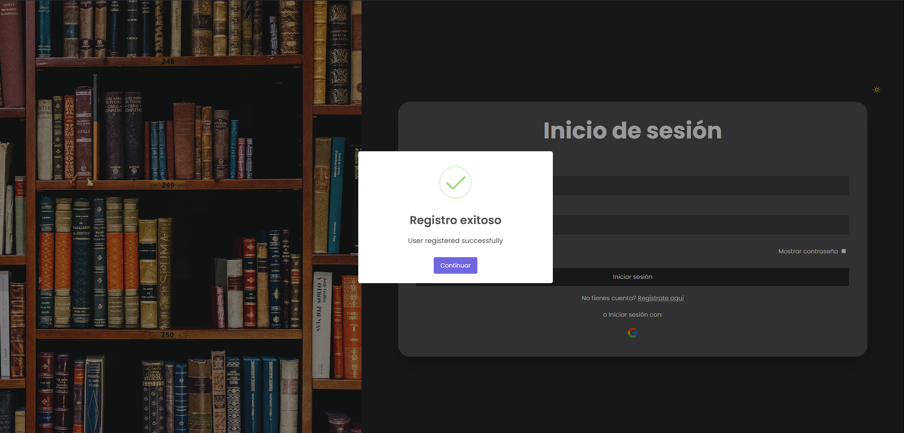
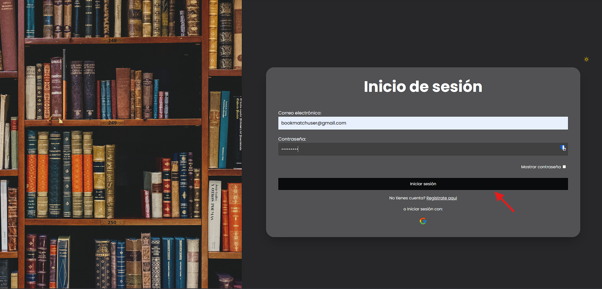
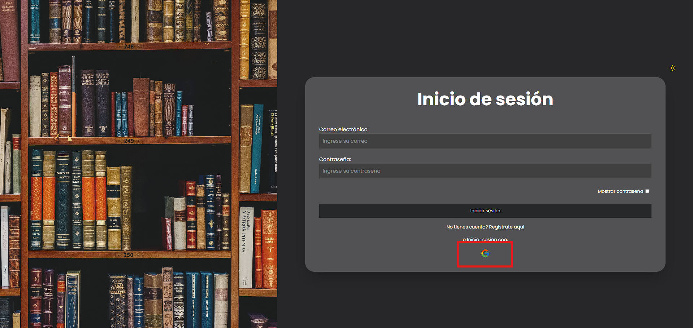
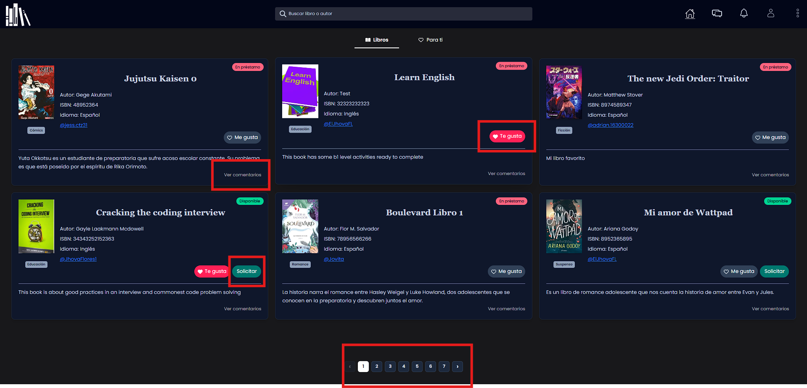

# Overview

This was a project required for university program. We had to focus on create a project to innovate and help others.

Bookmatch born as an idea to share books and bring security between users...

    
Login and Register

## Register

 > User can register his account with his real gmail, after adding the credentials manually or using google.

### Manually

Once you are on Register page add your credentials manually then click on submit button

A modal will pop up and introduce the code received via mail to verify the mail address

You will be redirected to login page with a success message

### Google

Then click on Google icon 

Select the account you want to register and let google do it

Once is done

## Login

> User can sing up his account with his real gmail, once has added the credentials manually or using google.

### Manually

Add credentials and click on submit button then you will be in home page

### Google

Click on google icon in login page

Then select the account and you will be in home page

    
Homepage

As you can see in the home page there are book cards with essential information. Some important information is displayed.

Actions on this page:

- Liking books: This helps to train the k-means algorithm, once it is trained you can visualize recommendations in For You tab.
- View comments: This display a modal to see comments left on the book and post new comments
- Request a book to book's owner: This triggers a request that owner has to accept or deny.
- Move other books: There is a pagination that avoid get too much books from backend and keep the query fast

###  Note

In this repo we're adding documentation about Projecto modular and things we think are important to keep easy access

As a collaborator feel free to modify this markdown as long as you are following MD syntax rules

### Documentation links

[IEEE DOCUMENT](https://docs.google.com/document/d/1mLF7090NzrJhLA9YUJWiEZ7_enC_3GOSiRYUyXb64gI/edit?usp=sharing ) -
Requirement specification document

[Figma Desing](https://www.figma.com/design/34GIcbvp4FpIKh9K4uaaWb/Proyecto-Modular?node-id=0-1&p=f&t=4z8hYSzqaRw0p5lI-0) - Figma desing proyect **ask for authorization**

[Use Case Diagram](https://lucid.app/lucidchart/02368ea8-910c-4010-888d-e97c29fdd83d/edit?page=0_0&invitationId=inv_240a06a3-a8d8-4d62-a538-96affdf015ff#) - A brief overview of how users will interact with the app **ask for authorization**

[Activity diagram](https://lucid.app/lucidchart/9b235a27-fd11-43af-b4ad-9297f87cf67b/edit?viewport_loc=308%2C-290%2C3198%2C1590%2C0_0&invitationId=inv_4011781a-d61e-40c1-b9d6-5d5c387b038b). Activity Diagram 

### Important links

[Markdown Basic Syntax](https://www.markdownguide.org/basic-syntax/) - Best practices for markdown format

[Free File Converter](https://www.freeconvert.com/) - Used to convert any image format to webp

