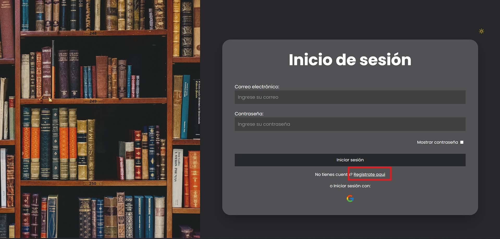
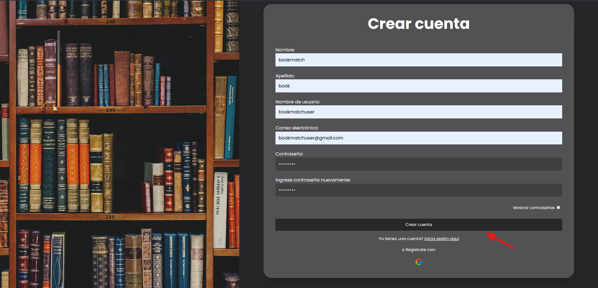
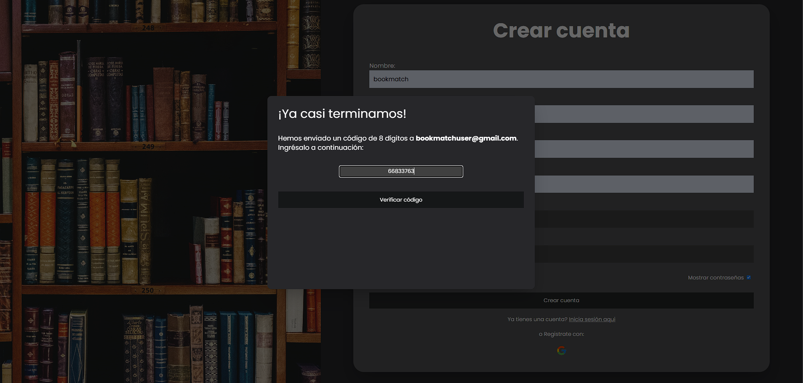
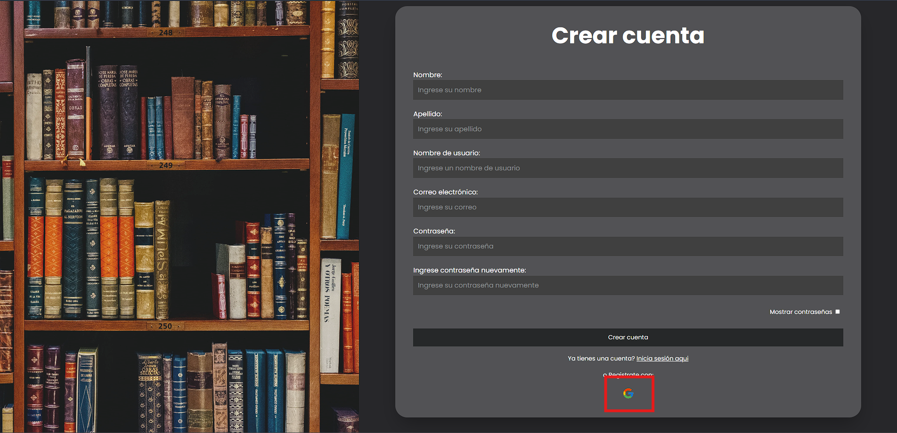
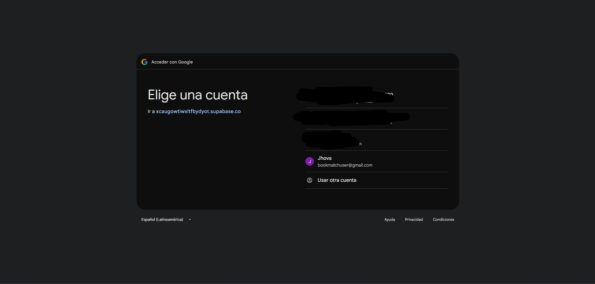
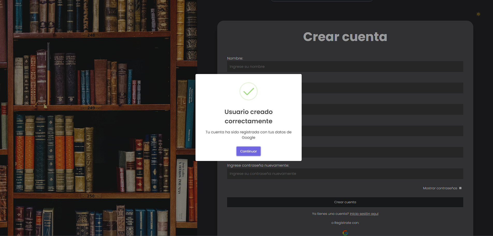

# Overview

This was a project required for university program. We had to focus on create a project to innovate and help others.

Bookmatch born as an idea to share books and bring security between users...

    
Login and Register

User can register his account with his real gmail, after adding the credentials he will receive a mail with the auth code generated

Once you are on Register page add your credentials manually then click on submit button

A modal will pop up and introduce the code received via mail to verify the mail address

User can also register his account with google authentication. To register an account using google move to Register pages

Then click on Google icon 

Select the account you want to register and let google do it

Once is done

###  Note

In this repo we're adding documentation about Projecto modular and things we think are important to keep easy access

As a collaborator feel free to modify this markdown as long as you are following MD syntax rules

### Documentation links

[IEEE DOCUMENT](https://docs.google.com/document/d/1mLF7090NzrJhLA9YUJWiEZ7_enC_3GOSiRYUyXb64gI/edit?usp=sharing ) -
Requirement specification document

[Figma Desing](https://www.figma.com/design/34GIcbvp4FpIKh9K4uaaWb/Proyecto-Modular?node-id=0-1&p=f&t=4z8hYSzqaRw0p5lI-0) - Figma desing proyect **ask for authorization**

[Use Case Diagram](https://lucid.app/lucidchart/02368ea8-910c-4010-888d-e97c29fdd83d/edit?page=0_0&invitationId=inv_240a06a3-a8d8-4d62-a538-96affdf015ff#) - A brief overview of how users will interact with the app **ask for authorization**

[Activity diagram](https://lucid.app/lucidchart/9b235a27-fd11-43af-b4ad-9297f87cf67b/edit?viewport_loc=308%2C-290%2C3198%2C1590%2C0_0&invitationId=inv_4011781a-d61e-40c1-b9d6-5d5c387b038b). Activity Diagram 

### Important links

[Markdown Basic Syntax](https://www.markdownguide.org/basic-syntax/) - Best practices for markdown format

[Free File Converter](https://www.freeconvert.com/) - Used to convert any image format to webp

